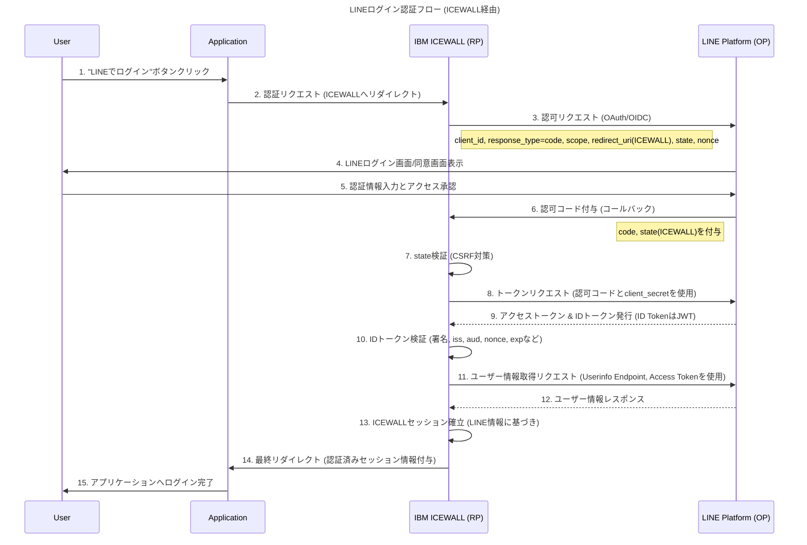

## シーケンス図

## 補足

このシーケンス図は、LINEログインで一般的に使用されるOAuth 2.0の認可コードフローとOpenID Connectの組み合わせに基づいています。

ICEWALL (RP): ICEWALLは**リライングパーティ（Relying Party）**として機能し、LINEが発行したIDトークンを検証し、アプリケーションへのアクセスを許可します。

LINE (OP): LINEは**OpenIDプロバイダ（OpenID Provider）**として機能し、ユーザー認証とトークン発行を行います。

バックチャネル通信: ステップ8～12は、ユーザーのブラウザを介さず、ICEWALLとLINE間で直接行われる安全なバックチャネル通信です。